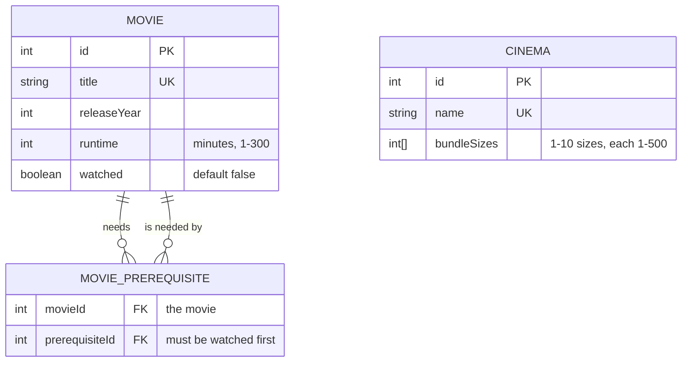

# Doomsday Ready

A small full-stack app that helps MCU fans plan their rewatch before *Avengers: Doomsday* and book an opening-night watch party.

**Stack:** React (Vite) + Tailwind CSS v4 · Node.js + Express · Prisma · PostgreSQL

## Quick start (Docker, one command)

Requires Docker Desktop (or Docker Engine with the Compose plugin).

```bash
docker compose up --build
```

- App: http://localhost:5173
- API: http://localhost:4000/api/health

Three containers start in order: PostgreSQL → API → web app (nginx).

- The API container applies the database migration and seeds the sample movies and cinemas on every start (the seed is safe to repeat), then starts the server.
- The web container serves the built React app and forwards `/api` requests to the API container, so the browser only talks to `localhost:5173`.
- Data is kept in a Docker volume (`pgdata`). To start from scratch: `docker compose down -v`.

If port 5173 or 4000 is already in use, stop the local dev servers first or change the left side of the port mapping in `docker-compose.yml`.

## Run locally (without Docker)

1. Create an empty PostgreSQL database.
2. Configure the server:

   ```bash
   cd server
   cp .env.example .env      # then fill DB_USER, DB_PASSWORD, DB_NAME
   npm install               # installs Prisma 7 locally and generates the client
   npm run db:migrate        # creates the tables (runs the project's own Prisma 7; the connection URL lives in `prisma.config.ts`)
   npm run db:seed           # optional: sample data from the assessment
   npm run dev               # http://localhost:4000
   ```

   `.env` uses `DB_HOST`, `DB_PORT`, `DB_USER`, `DB_PASSWORD`, `DB_NAME`. `DATABASE_URL` is built from them
   (you can also set `DATABASE_URL` directly). `FRONTEND_URL` is the web app's address that the API allows
   through CORS (`http://localhost:5173` locally; leave it empty to allow any origin).

3. Start the client in another terminal:

   ```bash
   cd client
   npm install
   npm run dev               # http://localhost:5173 (proxies /api to :4000)
   ```

## Tests

```bash
cd server && npm test
```

- `algorithms.test.js` – cycle detection, rewatch order and bundle quotes, including every expected result from the brief.
- `api.test.js` – HTTP-level checks of validation, status codes and responses (uses an in-memory stand-in for Prisma, so no database is needed).

## Deploy on Vercel

Create two Vercel projects from the same GitHub repo.

1. **Database.** Create a free PostgreSQL database (for example on Neon) and copy its connection string.
2. **Tables and sample data** (run once from your computer, in `server/`, with `DATABASE_URL` set to the connection string):
   ```powershell
   npm run db:migrate
   npm run db:seed
   ```
   For migrations use Neon's direct connection (the host without `-pooler`).
3. **API project.** Import the repo, set *Root Directory* to `server`, framework *Other*, leave the build command empty. Add `DATABASE_URL` (the pooled connection string) and deploy. Check `https://<api-domain>/api/health`.
4. **Web project.** Import the same repo, set *Root Directory* to `client` (framework: Vite), add `VITE_API_URL = https://<api-domain>/api` (no trailing slash), deploy.
5. **CORS.** On the API project add `FRONTEND_URL = https://<web-domain>` (no trailing slash, comma-separate several) and redeploy the API.

Environment variables only take effect after a redeploy, and `VITE_API_URL` is written into the web app at build time.

## API (`/api`)

| Method and path | Purpose |
| --- | --- |
| `POST /movies` | Create a movie (or an array of movies) |
| `GET /movies` | List movies |
| `GET /movies/:id` | Get one movie |
| `PATCH /movies/:id` | Update title, year, runtime, `watched`, `prerequisites` |
| `GET /movies/:id/rewatch-order` | Rewatch order (feature 1) |
| `POST /cinemas` | Create a cinema (or an array of cinemas) |
| `GET /cinemas` | List cinemas |
| `GET /cinemas/:id/booking?groupSize=6` | Booking quote (feature 2) |

Movie JSON: `{ id, title, releaseYear, runtime, watched, prerequisites: [movieId, ...] }`.
Send prerequisites as an array of ids (`prerequisites` or `prerequisiteIds`).

Rewatch order response:

```json
{
  "movie": { "id": 8, "title": "Avengers: Doomsday" },
  "order": [{ "id": 1, "title": "Iron Man", "releaseYear": 2008, "runtime": 126, "watched": false }],
  "totalCount": 7,
  "watchedCount": 0,
  "unwatchedRuntime": 1000
}
```

Booking response: `{ cinema, groupSize, possible, totalBundles, bundles: [{ size, count }] }`.
When no exact combination exists: `possible: false`, `totalBundles: null`, `bundles: []` and a `message`.

Errors are `{ "error": { "code", "message" } }`:
`400 VALIDATION_ERROR`, `404 NOT_FOUND`, `409 CIRCULAR_DEPENDENCY`, `409 DUPLICATE`.

## Backend structure (modular)

```
server/src
├── server.js                 # starts the HTTP server
├── app.js                    # express app, middleware, error handling
├── routes.js                 # mounts every module under /api
├── config/                   # env + Prisma client
├── common/                   # shared ApiError, middleware, validators
└── modules/
    ├── movies/
    │   ├── movies.routes.js       # URL -> controller
    │   ├── movies.controller.js   # HTTP in/out only
    │   ├── movies.service.js      # business rules (cycle check, rewatch plan)
    │   ├── movies.repository.js   # Prisma queries only
    │   ├── movies.validation.js   # request validation
    │   └── movies.graph.js        # hand-written cycle detection + topological order
    └── cinemas/
        ├── cinemas.routes.js / .controller.js / .service.js / .repository.js / .validation.js
        └── cinemas.bundles.js     # hand-written min-bundle DP
```

## How the logic works (written by hand, no helper libraries)

**Circular dependency check.** Before saving new prerequisites for movie *M*, walk the prerequisite edges
starting from those new prerequisites (iterative DFS). If *M* is reached, *M* would depend on itself, so the
change is rejected with `409 CIRCULAR_DEPENDENCY`. Listing itself as a prerequisite is rejected the same way.

**Rewatch order.** Iterative DFS post-order from the target: a movie is emitted only after all of its
prerequisites, a visited set guarantees each movie appears once, and the target is left out. Prerequisites are
visited in id order so results are deterministic. Watched count and the remaining runtime are computed from that list.

**Booking quote.** Unbounded coin-change dynamic programming: `best[n]` is the fewest bundles that add up to exactly
`n` seats, for `n` up to the group size (max 10,000 × 10 sizes, instant). Greedy would be wrong (for sizes 1, 3, 4
and 6 seats it gives 3 bundles, the DP finds 3 × 2). The chosen bundles are rebuilt by walking back through the table.
On ties the larger bundle is preferred.

## Assumptions

- Release year must be an integer from 1888 to 2100.
- A cinema's duplicate bundle sizes are collapsed (sizes must be *different*), then 1–10 sizes are required.
- Updating `prerequisites` replaces the whole list.
- Movie titles and cinema names are unique (duplicates return `409 DUPLICATE`).
- `unwatchedRuntime` is in minutes.
- Cycle checks read the graph and then write; two simultaneous edits could in theory race. Acceptable for this scope.

## Data model



(In Prisma this is an implicit many-to-many self relation, stored in the `_MoviePrerequisites` table.)

## How AI tools were used

Claude (Anthropic) helped scaffold the project: the Express/Prisma setup, validation, React components, Docker files
and this README. The logic of features 1 and 2 (cycle detection, rewatch ordering, bundle quote) was reviewed against
the brief and covered by the tests above.
