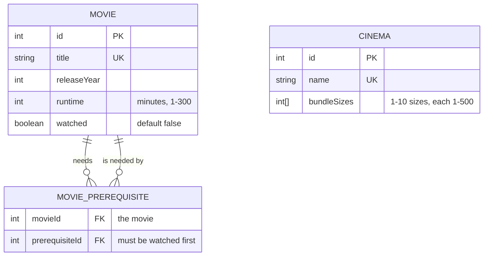

# Doomsday Ready — API

Backend for **Doomsday Ready**, a small app that helps MCU fans plan their rewatch before *Avengers: Doomsday* and book an opening-night watch party.

- **Web app (React):** https://github.com/Debos602/doomsday-ready-client
- **Live app:** https://doomsday-ready-client-virid.vercel.app
- **Live API:** `https://<your-api-domain>/api/health`

**Stack:** Node.js · Express 4 · Prisma 7 · PostgreSQL (Neon in production)

## Features

1. **Movies.** Unique title, release year, runtime (1–300 min), optional prerequisites, `watched` flag. Saving a prerequisite that would make a movie depend on itself (directly or through other movies) is rejected with `409 CIRCULAR_DEPENDENCY`. A rewatch-order endpoint returns what to watch, in order, with the watched count and the unwatched runtime.
2. **Cinemas.** Each cinema sells 1–10 different bundle sizes (each 1–500). A booking quote returns the fewest bundles for a group of 1–10,000 people, or says it is not possible.

The logic for both is written by hand (no helper libraries).

## Run locally

Requirements: Node.js 20+ and a PostgreSQL database.

```bash
npm install                # installs dependencies and generates the Prisma client
cp .env.example .env       # then fill in the database values (see below)
npm run db:migrate         # creates the tables
npm run db:seed            # optional: sample movies and cinemas
npm run dev                # http://localhost:4000
```

Check it works: http://localhost:4000/api/health → `{"status":"ok"}`

### Environment variables (`.env`)

| Variable | Purpose |
| --- | --- |
| `PORT` | Port to listen on (default `4000`) |
| `DATABASE_URL` | PostgreSQL connection string. If it is missing, it is built from the `DB_*` values below |
| `DB_HOST`, `DB_PORT`, `DB_USER`, `DB_PASSWORD`, `DB_NAME` | Used to build `DATABASE_URL` for local development |
| `FRONTEND_URL` | Web app origin allowed by CORS, for example `https://doomsday-ready-client-virid.vercel.app`. Separate several with commas. Leave empty to allow any origin |

Never commit `.env`. It is listed in `.gitignore`.

### Scripts

| Script | What it does |
| --- | --- |
| `npm run dev` | Start with auto-reload |
| `npm start` | Start normally |
| `npm test` | Run the tests |
| `npm run db:migrate` | Apply migrations (`prisma migrate deploy`) |
| `npm run db:seed` | Insert the sample data (safe to run again) |
| `npm run db:check` | Print which database URL is used and test the connection |

## API (`/api`)

| Method and path | Purpose |
| --- | --- |
| `GET /health` | Health check |
| `POST /movies` | Create a movie (or an array of movies) |
| `GET /movies` | List movies |
| `GET /movies/:id` | Get one movie |
| `PATCH /movies/:id` | Update title, year, runtime, `watched`, `prerequisites` |
| `GET /movies/:id/rewatch-order` | Rewatch order |
| `POST /cinemas` | Create a cinema (or an array of cinemas) |
| `GET /cinemas` | List cinemas |
| `GET /cinemas/:id/booking?groupSize=6` | Booking quote |

Movie JSON: `{ id, title, releaseYear, runtime, watched, prerequisites: [movieId, ...] }`.
Send prerequisites as an array of ids (`prerequisites` or `prerequisiteIds`).

Rewatch order response:

```json
{
  "movie": { "id": 8, "title": "Avengers: Doomsday" },
  "order": [{ "id": 1, "title": "Iron Man", "releaseYear": 2008, "runtime": 126, "watched": false }],
  "totalCount": 7,
  "watchedCount": 0,
  "unwatchedRuntime": 1000
}
```

Booking response: `{ cinema, groupSize, possible, totalBundles, bundles: [{ size, count }] }`.
When no exact combination exists: `possible: false`, `totalBundles: null`, `bundles: []` and a `message`.

Errors always look like `{ "error": { "code", "message" } }`:

| Status | Code | When |
| --- | --- | --- |
| 400 | `VALIDATION_ERROR` | Invalid input |
| 404 | `NOT_FOUND` | Movie or cinema does not exist |
| 409 | `CIRCULAR_DEPENDENCY` | The prerequisites would create a cycle |
| 409 | `DUPLICATE` | Title or cinema name already exists |

## Project structure

```
src
├── server.js                 # starts the HTTP server
├── app.js                    # express app, CORS, error handling
├── routes.js                 # mounts every module under /api
├── config/                   # env + Prisma client
├── common/                   # shared ApiError, middleware, validators
└── modules/
    ├── movies/
    │   ├── movies.routes.js       # URL -> controller
    │   ├── movies.controller.js   # HTTP in/out only
    │   ├── movies.service.js      # business rules (cycle check, rewatch plan)
    │   ├── movies.repository.js   # Prisma queries only
    │   ├── movies.validation.js   # request validation
    │   └── movies.graph.js        # hand-written cycle detection + ordering
    └── cinemas/
        ├── cinemas.routes.js / .controller.js / .service.js / .repository.js / .validation.js
        └── cinemas.bundles.js     # hand-written min-bundle DP
prisma/                       # schema, migration, seed
test/                         # algorithm and HTTP tests
```

## How the logic works

**Circular dependency check.** Before saving new prerequisites for movie *M*, walk the prerequisite edges starting from those new prerequisites (iterative DFS). If *M* is reached, *M* would depend on itself, so the change is rejected with `409 CIRCULAR_DEPENDENCY`. Listing itself as a prerequisite is rejected the same way.

**Rewatch order.** Iterative DFS post-order from the target: a movie is emitted only after all of its prerequisites, a visited set guarantees each movie appears once, and the target is left out. Prerequisites are visited in id order so results are deterministic. Watched count and the remaining runtime come from that list.

**Booking quote.** Unbounded coin-change dynamic programming: `best[n]` is the fewest bundles that add up to exactly `n` seats, for `n` up to the group size. Greedy would be wrong: with bundle sizes 1, 3 and 4 and a group of 6, taking the biggest first gives 4 + 1 + 1 (3 bundles), but the best answer is 3 + 3 (2 bundles). The chosen bundles are rebuilt by walking back through the table. On ties the larger bundle is preferred.

## Tests

```bash
npm test
```

- `algorithms.test.js` — cycle detection, rewatch order and bundle quotes, including every expected result from the brief.
- `api.test.js` — HTTP-level checks of validation, status codes and responses. It uses an in-memory stand-in for Prisma, so no database is needed.

## Data model



In Prisma this is an implicit many-to-many self relation, stored in the `_MoviePrerequisites` table.

## Deploy on Vercel

1. Create a free PostgreSQL database (for example on Neon) and copy its connection string.
2. Create the tables and sample data once from your computer (in this folder, with `DATABASE_URL` set to the connection string): `npm run db:migrate` then `npm run db:seed`. For migrations use Neon's direct connection (the host without `-pooler`).
3. Import this repo in Vercel. Leave the *Root Directory* empty, framework *Other*, build command empty.
4. Add environment variables: `DATABASE_URL` (the pooled connection string) and `FRONTEND_URL` (the web app's URL, no trailing slash).
5. Deploy and open `https://<your-api-domain>/api/health`.

`api/index.js` exposes the Express app as a serverless function and `vercel.json` routes every path to it.

## Assumptions

- Release year must be an integer from 1888 to 2100.
- A cinema's duplicate bundle sizes are collapsed (sizes must be *different*), then 1–10 sizes are required.
- Updating `prerequisites` replaces the whole list.
- Movie titles and cinema names are unique (duplicates return `409 DUPLICATE`).
- `unwatchedRuntime` is in minutes.
- Cycle checks read the graph and then write, so two simultaneous edits could in theory race. This is acceptable for this scope.

## How AI tools were used

<!-- Rewrite this section in your own words before submitting. -->
Claude (Anthropic) helped scaffold the project: the Express and Prisma setup, validation, Docker files and these READMEs. The logic for cycle detection, rewatch ordering and the bundle quote was reviewed against the brief and is covered by the tests.
